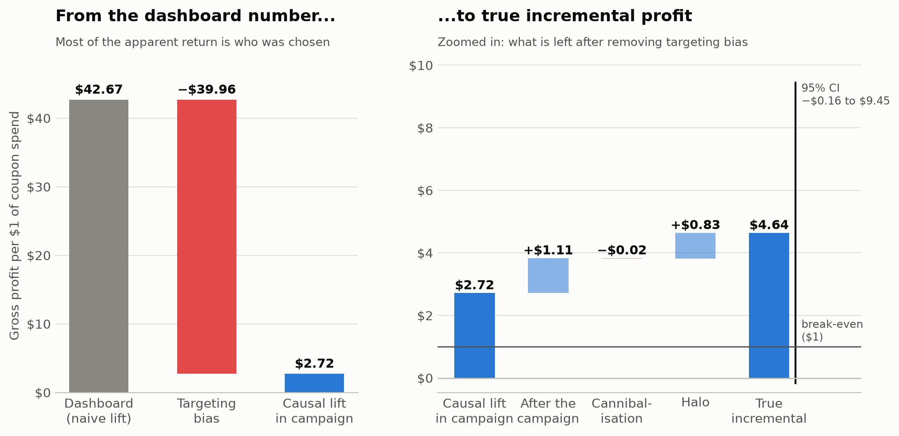
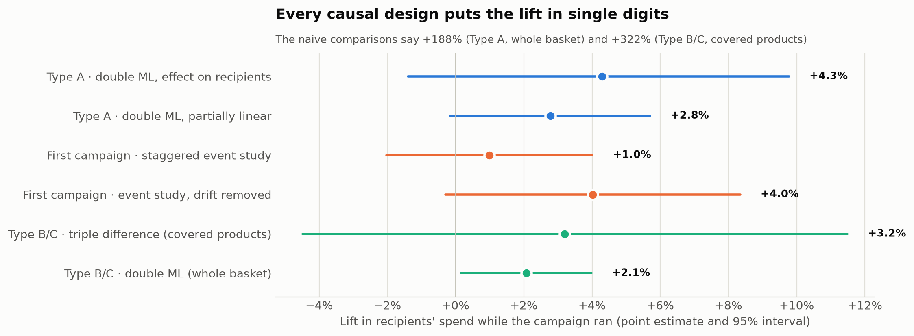
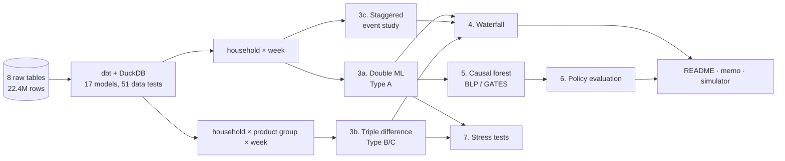
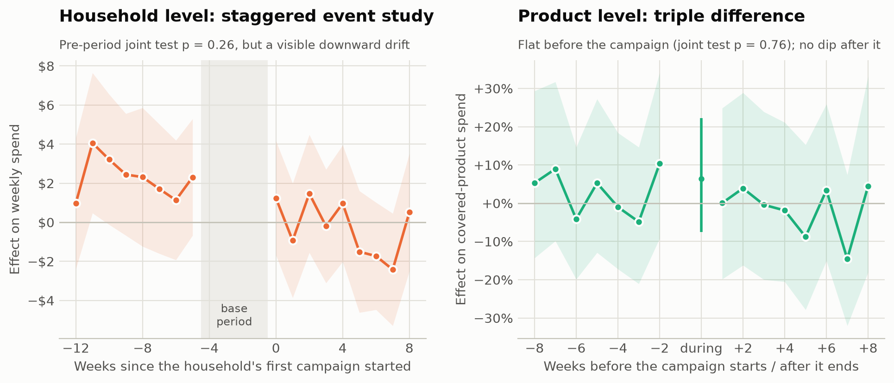
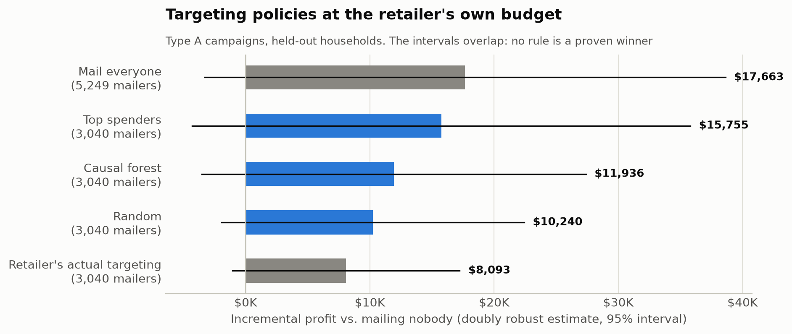
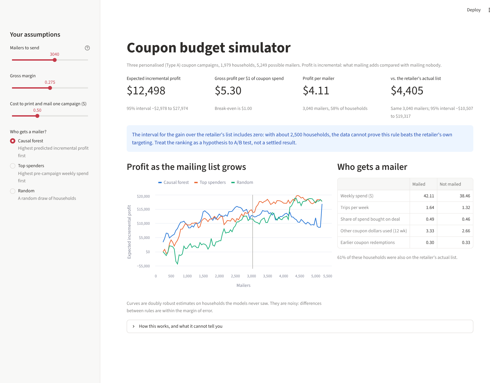

# Do Coupons Create Sales or Just Give Away Money?

[](https://github.com/VicDeni/coupon-incrementality/actions/workflows/ci.yml)

**A grocery retailer's dashboard would credit its coupon campaigns with about $43 of gross profit for every $1 spent. Once you account for the fact that coupons were mailed to the retailer's best customers, the best estimate is about $4.60, and break-even cannot be ruled out (95% interval −$0.16 to $9.45).** About 89% of the apparent return comes from who was chosen, not from what the coupon did.



Built on one year of real purchases: 1.47 million transactions from 2,469 households and 27 coupon campaigns ([84.51° Complete Journey](https://github.com/bradleyboehmke/completejourney)). Everything here rebuilds from the raw data with `make all`.

## What I found

| | Finding | Evidence |
|---|---|---|
| 1 | **The dashboard number is almost all selection.** Coupon recipients spend $52.70 a week against $18.33 for everyone else, a "lift" of 188%. | Three causal designs with different assumptions put the real lift between 1% and 5%. |
| 2 | **Personalised coupons carry most of the return, but it is not nailed down.** Type A campaigns (16 coupons picked from each household's own history) return an estimated $5.71 per $1. | Double ML: +$2.20 per household per week (95% CI −$0.71 to +$5.01). Four household-level designs all land between $2.62 and $5.71 per $1, and every interval includes break-even. |
| 3 | **Same-for-everyone coupons do not pay for themselves directly.** Type B/C coupons lifted sales of the covered products by 3%, about 15 cents per household, against 68 cents of cost. | Triple difference: +3.2% (95% CI −4.5% to +11.5%). Any payoff depends on a store-wide halo the data cannot pin down. |
| 4 | **No stockpiling and no cannibalisation worth the name.** Purchases did not dip after campaigns ended, and competing products in the same category did not lose. | After-campaign effect −4.6% (not significant); sibling products −0.5%. |
| 5 | **There is no reliable evidence that some households respond more than others.** A causal forest's predicted top fifth measured +$5.49 a week and its bottom fifth +$1.66, but the ranking carries no signal out of sample. | BLP slope 0.00 (SE 0.80); GATES top minus bottom p = 0.38. |
| 6 | **No targeting rule provably beats the retailer's own.** Point estimates favour mailing more households, but every interval includes zero. | Doubly robust off-policy evaluation on held-out households. |

For a marketing audience, the [two-page memo](reports/memo.md) gives the recommendation, the dollar impact and the risks without the jargon. Every number in this README comes from [reports/RESULTS.md](reports/RESULTS.md), which the pipeline generates.

## The question, and why it is hard

Retailers count every coupon redemption as a win. But many redemptions come from shoppers who would have bought anyway, some just pull a purchase forward, and some move spending from one brand to its neighbour on the shelf. The question a marketing VP actually needs answered is: **for every $1 of coupon spend, how much incremental profit comes back, and from whom?**

It is hard because the retailer did not hand out coupons at random. It mailed them to its most engaged shoppers, who spend more whatever happens. Comparing recipients with everyone else mixes up the coupon's effect with the choice of recipient.



## How the answer was built



| Phase | What it does | Key design choice |
|---|---|---|
| 1. Data layer | Loads the raw tables into DuckDB and models them in dbt, with tests on keys, ranges and reconciliation to the raw totals. | The north-star metric, incremental gross profit per $1 of coupon spend, is defined before any modelling. |
| 2. Naive baseline | Reproduces the dashboard: recipients vs. non-recipients, redeemers vs. non-redeemers. | This is the first bar of the waterfall. |
| 3a. Double ML | Type A campaigns. Compares recipients with non-recipients who had the same purchase history, using 221 pre-campaign features and gradient-boosted models. | Outcome is the change from each household's own baseline; 29% of rows with no comparable counterpart are trimmed; errors clustered by household. |
| 3b. Triple difference | Type B/C campaigns. Recipients vs. non-recipients × covered vs. other products × campaign vs. other weeks, with household×week, product-group×week and household×product-group fixed effects. | Poisson rather than OLS, because shocks hit big and small baskets by the same percentage, not the same dollars. |
| 3c. Event study | Callaway–Sant'Anna estimator for households entering the program at different dates, using not-yet-treated households as controls. | Written out in numpy and unit-tested against simulated data with a known answer. |
| 4. Decomposition | After-campaign effect, cannibalisation (sibling products) and halo (rest of store). | Type A is measured on the whole basket, which already nets out switching and includes halo. |
| 5. Heterogeneity | Causal forest, then BLP and GATES tests out of sample. | Segments are reported only as far as the tests support them. |
| 6. Targeting policy | Five policies at the same budget, scored with doubly robust off-policy evaluation on held-out households. | Margin (25–30%) and mailing cost are assumptions, shown as ranges. |
| 7. Stress tests | Placebo dates, placebo products, one-campaign-at-a-time, sensitivity to hidden confounding. | Failures are reported, not hidden (see below). |

Two things about the data shaped the design:

- **Type A coupons are personalised and unrecorded.** Each household got 16 coupons chosen from its own purchase history, but which 16 is not in the data. So Type A is measured at the household level. Because the history that drove targeting *is* in the data, conditioning on it is credible.
- **Type B/C coupons are identical for every recipient**, so we know exactly which products each household held a coupon for. That is what makes the product-level triple difference possible.

Of the 27 campaigns, 22 could be analysed: 3 Type A and 19 Type B/C. The other five start before the data does, in its final week, or too early to have a purchase history.

## Do the designs agree?

They agree on the conclusion and on the order of magnitude: every estimate of the lift is in single digits, against naive figures of +188% and +322%. They do not agree on the decimal, and none is individually significant at 5%.

| Design | Assumption it rests on | Estimate | Check |
|---|---|---|---|
| Double ML (Type A) | Targeting depended only on purchase history we can see | +$2.20 per week (+4.3%) | Placebo dates: +$1.24, n.s. ✔ |
| Triple difference (Type B/C) | Covered products would have tracked the household's other purchases | +3.2% on covered products | Flat pre-trends, p = 0.76 ✔ · placebo products −0.6% ✔ · placebo dates ✘ (see below) |
| Event study (first campaign) | Recipients and not-yet-recipients were on parallel paths | +$0.51 per week (+1.0%) | Pre-trend test p = 0.26, but a visible drift; +$2.06 with the drift removed |

The headline uses the double-ML and triple-difference estimates. Type A's return under each household-level design ranges from $2.62 to $5.71 per $1; all of those intervals include break-even.



## What went wrong, and what I did about it

**The placebo-date test failed for the triple difference.** Pretending each Type B/C campaign started eight weeks early should show nothing. It showed −17% (p < 0.001). The cause is mean reversion: households were picked because they had recently bought the covered products heavily, and their purchases fell back between weeks −16…−9 and −8…−1. Any baseline reaching back further than eight weeks is contaminated. Within the eight-week baseline the pre-trends are flat (p = 0.76), a four-week baseline gives the same answer (+4.0%), and if reversion were still in progress the bias would run *against* finding an effect. I kept the estimate and report the failure.

**The first halo estimate was implausible.** A difference-in-differences on rest-of-store spend said coupons *reduced* it by 2.3% (p = 0.016). Recipients' spending was already drifting down relative to everyone else before any campaign, so that design measures the drift. I replaced it with a double-ML estimate that conditions on each household's own history: +$6.26 per household-campaign, 95% CI −$1.24 to +$13.77. The halo bar in the waterfall is therefore the least certain one.

**Adjusting the event study for baseline spend made it worse.** Conditioning on lagged spend in a difference-in-differences invites regression to the mean; the pre-trend test went from p = 0.26 to p < 0.001. I reverted to the unadjusted version and report a drift-sensitivity estimate instead.

**OLS found coupon effects on products with no coupons.** The linear triple difference gave a +$0.49 "effect" on placebo products, nearly as large as on covered ones. That is a scale artefact, and the reason the model is Poisson.

**The segments did not survive.** In an earlier run the forest's out-of-sample ranking looked promising (top versus bottom fifth, p = 0.10). After the data fix below, the BLP slope is 0.00 and GATES gives p = 0.38. The forest is finding noise, and its policy's gain over the retailer's targeting (+$3,844, 95% interval −$11,037 to +$18,724) is not evidence of anything. Responder profiles are therefore not reported as findings.

**A data test caught silently dropped rows, and fixing them moved the result.** 4,836 basket lines (about $170 of sales) referenced products missing from the catalog and were being lost in a join; the dbt reconciliation test failed until they were kept. Rebuilding from scratch with that fix nudged every household's features and moved the primary Type A estimate from +$3.11 (interval clear of zero) to +$2.20 (interval includes zero). A conclusion that flips with $170 of input was never a firm one, so the README reports the rebuilt numbers and says so plainly.

## Targeting under a budget



At the retailer's own budget (3,040 mailers across three Type A campaigns), no rule is statistically distinguishable from another, and no policy's profit is clearly above zero. The point estimates lean towards *reach* rather than *reallocation*: mailing every household with a comparable counterpart is estimated at $17,663 of incremental profit (95% CI −$3,301 to $38,628) against $8,093 for the actual list. That is a hypothesis for a holdout test, not a recommendation to scale.

The [Streamlit simulator](app/streamlit_app.py) lets a marketing team choose a budget, a margin and a mailing cost and see who would be mailed and the expected profit, with intervals.



## How fragile is the Type A estimate?

- **Sampling noise is the main threat, not confounding.** The estimate is about 1.5 standard errors from zero. With roughly 3,000 recipient rows, that is the precision this data allows.
- **Hidden confounding.** A confounder would need to explain about 2.4% of the remaining variation in both targeting and spending to erase the double-ML estimate (4.5% in a transparent linear model). For scale: dropping *all 35 spending-history features* moves the estimate by $0.80. In the linear model, a hidden confounder three times as strong as pre-campaign spend would still leave +$1.87 (95% CI $0.45 to $3.29).
- **One campaign at a time.** Restricting to households with no overlapping campaign gives +$2.64 a week, essentially unchanged.
- **Specification.** The partially linear estimate is +$1.42 and the overall average effect +$1.80. All the variants land between +$1.42 and +$2.46 a week.

## Limitations

- **Margins and mailing cost are assumed, not observed.** Gross margin 25–30%, mailing 50 cents per household per campaign. At 25 cents the headline is $6.38; at $1.00 it is $3.00.
- **Redeemed coupon value is reconstructed.** The data records who redeemed which coupon, not its value; 1,130 of 2,102 redemptions could be matched to a basket line and the rest are imputed at the average.
- **Who funds the coupons is unknown.** Coupon face value is treated as a program cost. If manufacturers reimburse it, the retailer's own return is higher.
- **About 2,500 households.** Enough to say the lift is small; not enough to say for certain it is positive, or to rank households or targeting rules. A randomised holdout is the fix.
- **Type A coupons per household are unknown**, so Type A cannot be split into cannibalisation and halo.
- **Demographics cover a third of households**, so responder profiles rest on purchase behaviour.
- **One retailer, one year.** Replication on the original two-year dunnhumby release is implemented (`make replicate`) but **has not been run**: that dataset sits behind a download form.
- **The waterfall's interval treats its components as independent**, which is an approximation.

## Run it

```bash
git clone https://github.com/VicDeni/coupon-incrementality.git && cd coupon-incrementality
python -m venv .venv && source .venv/bin/activate      # Python 3.13
make install
make all          # downloads the data, builds the warehouse, runs every phase (~25 min, 8 GB RAM)
make test         # lint + 46 unit tests (the 51 dbt data tests run in `make data`)
make app          # coupon budget simulator
```

Or `docker build -t coupon-incrementality . && docker run --rm coupon-incrementality`.

## Repository map

```
dbt/                         staging → intermediate → marts, with schema and singular tests
src/coupon_incrementality/
  download.py                fetch and verify the dataset
  features.py                221 pre-campaign features per household × campaign
  naive.py                   Phase 2   dashboard numbers
  dml.py                     Phase 3a  double ML (DoubleML) + sensitivity
  triple_diff.py             Phase 3b  Poisson triple difference (pyfixest)
  event_study.py             Phase 3c  Callaway–Sant'Anna, bootstrap inference
  dml_bc.py                  Phase 4   halo and a second opinion for Type B/C
  decomposition.py           Phase 4   the waterfall
  heterogeneity.py           Phase 5   causal forest (econml), BLP, GATES
  policy.py                  Phase 6   off-policy evaluation of five policies
  robustness.py              Phase 7   placebos, overlap, sensitivity
  replicate.py               Phase 7   dunnhumby two-year replication (not yet run)
  aipw.py, sensemakr.py      shared estimators, tested against known answers
app/streamlit_app.py         coupon budget simulator
reports/                     figures, result files, RESULTS.md, the VP memo
tests/                       estimator tests on simulated data + warehouse checks
```

**Stack:** Python · SQL (DuckDB) · dbt · pandas · LightGBM · DoubleML · econml · pyfixest · statsmodels · Streamlit · pytest · Docker · GitHub Actions.

## Data and licence

Data: 84.51° / dunnhumby *The Complete Journey*, downloaded at build time from the `completejourney-py` package and not redistributed here, apart from a small anonymised extract of model scores that powers the simulator. Code: MIT.
